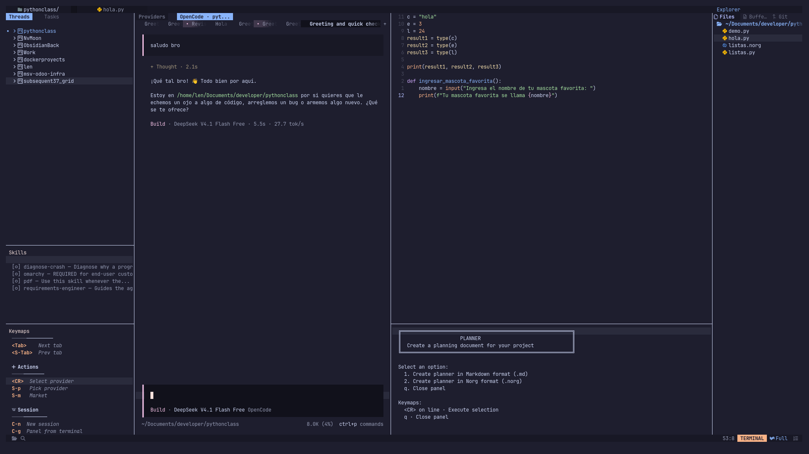
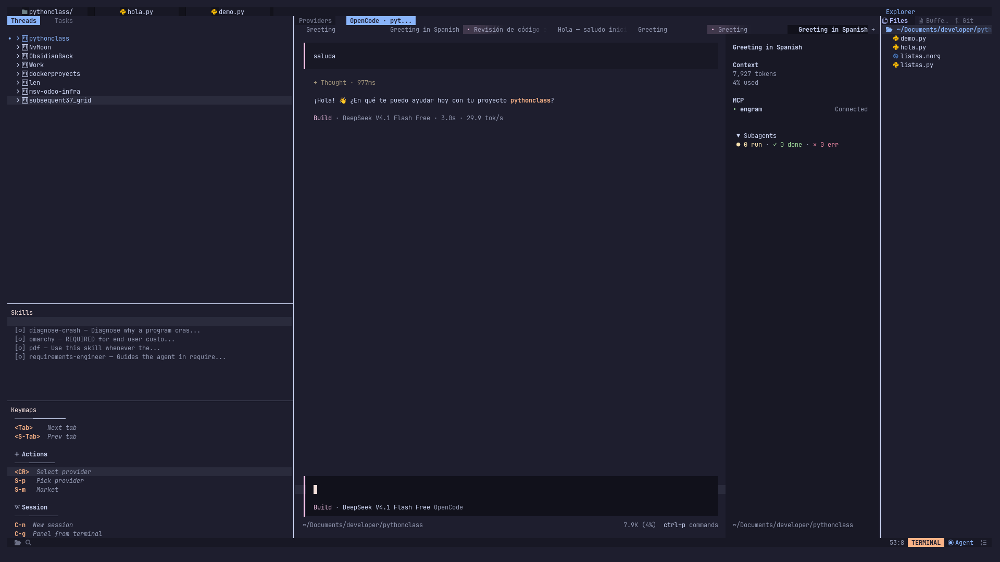
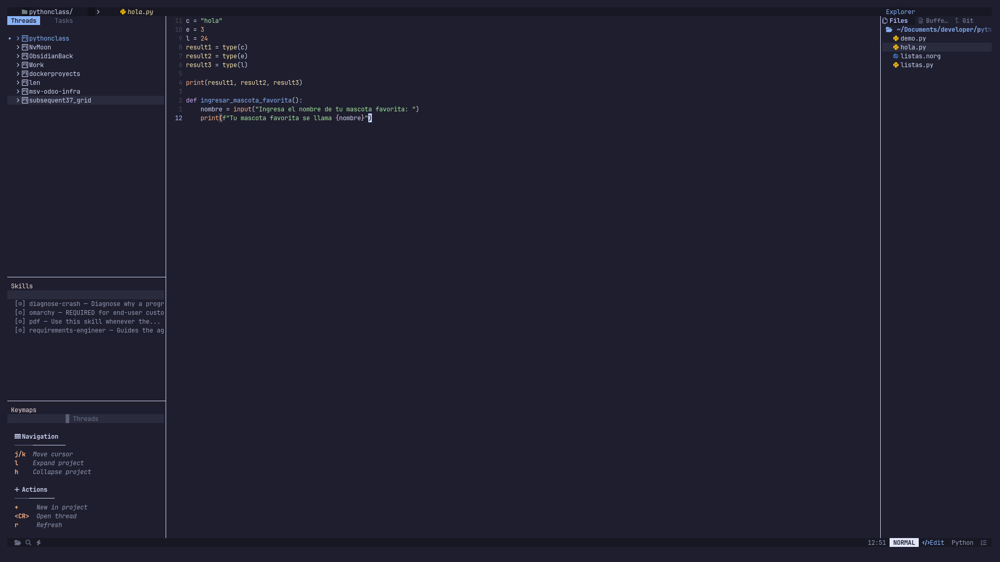
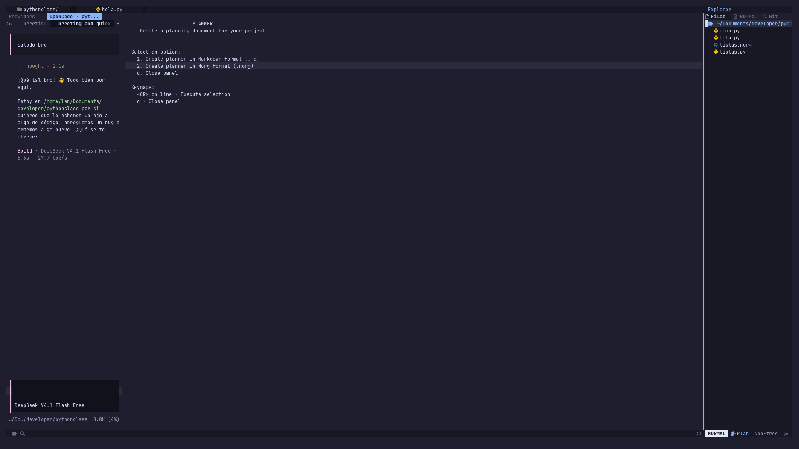

<div align="center">

# 🌙 NvMoon

> A modern, workspace-driven Neovim configuration with AI integration.

[](https://neovim.io)
[](https://www.lua.org)
[](https://github.com/folke/lazy.nvim)
[](https://github.com/catppuccin/neovim)

</div>

---

## ✨ Preview

<div align="center">

### Full Workspace — All Panels



*Agent panels, file explorer, editor buffers, and planner — everything in one view.*

</div>

---

## 🚀 Quick Start

```sh
mvim              # open in the current directory
mvim <dir>        # open and show neo-tree at <dir>
mvim <file>       # open a file
```

`mvim` is an alias: `NVIM_APPNAME=NvMoon nvim` (defined in `~/.zshrc`).

> When opening with `mvim <dir>`, the neo-tree cursor starts on **line 1 (the root node = the directory)**.
> Move down with `j` to a file before pressing `<CR>`; on the root node `<CR>` only expands/collapses.

---

## 🖼️ Workspace Gallery

NvMoon features **4 workspace modes** that let you switch the entire layout to match your current focus, similar to pages in DaVinci Resolve. The agent terminal is **preserved across mode switches**.

<div align="center">

| **Agent Mode** | **Edit Mode** |
|:---:|:---:|
| Agent panels take full priority with minimal distractions. | Editor-first layout with compact agent reference. |
|  |  |
| **Full Mode** | **Plan Mode** |
| All panels visible — the default workspace. | Dedicated requirements planning with elicitation tab. |
|  |  |

</div>

Switch workspaces with `space w` or cycle through modes with `space w w`. Current mode is shown in the status line (lualine).

---

## Index

- [Group quick reference](#group-quick-reference)
- [Global](#global)
- [Windows and panes](#windows-and-panes)
- [Text movement](#text-movement)
- [Indentation and selection](#indentation-and-selection)
- [Buffers](#buffers)
- [Search / Files](#search--files)
- [Explorer](#explorer)
- [Projects](#projects)
- [Notes (Norg)](#notes-norg)
- [Requirements](#requirements)
- [Workspaces](#workspaces)
- [LSP](#lsp)
- [Diagnostics and lists (Trouble)](#diagnostics-and-lists-trouble)
- [Git](#git)
- [Hunks (buffer-local)](#hunks-buffer-local)
- [Harpoon](#harpoon)
- [AI, Codex and Terminal](#ai-codex-and-terminal)
- [Remote (Distant)](#remote-distant)
- [Debug](#debug)
- [Flash](#flash)
- [UI / Colors](#ui--colors)
- [Completion](#completion)
- [Mappings inside neo-tree](#mappings-inside-neo-tree)
- [Inherited plugin mappings](#inherited-plugin-mappings)
- [Migration from the old scheme](#migration-from-the-old-scheme)

---

## Group quick reference

`leader` = `space`. Press `space ?` to see this same table inside Neovim.

| Key | Group | Contents |
|-----|-------|----------|
| `space a` | Agents | OpenCode, Codex, Claude Code, threads, shared panel |
| `space b` | Buffers | cycle, jump, close, sort |
| `space d` | Debug | breakpoints, dap-view, python tests |
| `space e` | Explorer | neo-tree, wayfinder |
| `space f` | Search | snacks picker |
| `space g` | Git | neogit |
| `space h` | Hunks / Harpoon | gitsigns + harpoon marks |
| `space l` | LSP | code actions, format, hover, symbols |
| `space n` | Notes | neorg, journal, table of contents |
| `space p` | Projects | neovim-project |
| `space w` | Workspaces | workspace modes (agent, edit, full, plan) |
| `space y` | Requirements | requirements workspace, planning panel |
| `space r` | Remote | distant.nvim |
| `space t` | Terminal | toggleterm |
| `space u` | UI | color picker |
| `space x` | Trouble | diagnostics, symbols, loclist, qflist |

---

## Global

| Mapping | Description | Mode |
|---------|-------------|------|
| `space w` | Write file | normal |
| `space q` | Quit / close window | normal |
| `space ?` | Which Key (all mappings) | normal |
| `g y` | Copy to system clipboard (`+` register) | normal, visual |
| `g p` | Paste from system clipboard | normal, visual |
| `[ q` | Previous error (quickfix) | normal |
| `] q` | Next error (quickfix) | normal |

---

## Windows and panes

| Mapping | Description | Mode |
|---------|-------------|------|
| `C-h` `C-j` `C-k` `C-l` | Window left / down / up / right | normal |
| `C-w` then `h` `j` `k` `l` | Move to the neighboring window in that direction | normal, terminal |
| `C-h` `C-j` `C-k` `C-l` | Same, jumping to normal from the terminal | terminal |
| `Alt-Up` `Alt-Down` `Alt-Left` `Alt-Right` | Move between windows without leaving insert | insert |
| `C-Up` / `C-Down` | Decrease / increase window height | normal |
| `C-Left` / `C-Right` | Decrease / increase window width | normal |

---

## Text movement

| Mapping | Description | Mode |
|---------|-------------|------|
| `Alt-j` | Move the line **down** and re-indent | normal, insert |
| `Alt-k` | Move the line **up** and re-indent | normal, insert |
| `Alt-j` / `Alt-k` | Move the visual block down / up | visual |

---

## Indentation and selection

| Mapping | Description | Mode |
|---------|-------------|------|
| `<` | Indent keeping the selection | visual |
| `>` | Dedent keeping the selection | visual |

---

## Buffers

| Mapping | Description |
|---------|-------------|
| `space b b` | Previous buffer |
| `space b n` | Next buffer |
| `space b j` | Jump to a buffer (list) |
| `space b e` | Pick which buffer to close |
| `space b h` | Close all buffers to the left |
| `space b l` | Close all buffers to the right |
| `space b L` | Sort by language |
| `space b D` | Sort by directory |
| `space b W` | Save **without** formatting (`noautocmd w`) |
| `Shift-h` / `Shift-l` | Previous / next buffer |

> The empty `[No Name]` startup buffer is automatically hidden from the bar.

---

## Search / Files

| Mapping | Description |
|---------|-------------|
| `space f f` | Find files |
| `space f g` | Live grep in the project |
| `space f w` | Grep the word under the cursor |
| `space f b` | Search across buffers |
| `space f r` | Recent files |
| `space f h` | Help tags |

---

## Explorer

| Mapping | Description |
|---------|-------------|
| `space e` | Open / close neo-tree |
| `space e f` | Wayfinder (find file by name in the tree) |

neo-tree sits on the **right**, width 30, and follows the current file.
The top selector has three sources: `Files`, `Buffers`, `Git` (also with `<` / `>`).

---

## Projects

| Mapping | Description |
|---------|-------------|
| `space p` | Recent projects |
| `space p o` | Open project (Zed-like) |
| `space p r` | Project history |

Detects projects in `~/dev/*` and `~/*` via `.git`, `.hg`, `.svn`, `package.json`, `go.mod`, `Cargo.toml`, `pyproject.toml`, `.project`.

---

## Notes (Norg)

`neorg` with the `norg` treesitter parser (installed from luarocks into
`stdpath("data")/lazy-rocks`). The default workspace is `~/notes`, with
`index.norg` as its root note; journals are flat files in `~/notes/journal/`.

| Mapping | Description |
|---------|-------------|
| `space n n` | New note in the workspace |
| `space n j` | Today's journal entry |
| `space n y` | Yesterday's journal entry |
| `space n t` | Insert / update the table of contents |
| `space n w` | Open the `notes` workspace |
| `space n i` | Open `~/notes/index.norg` |

Default `neorg` keybinds are kept under `<LocalLeader>` (`\ t d` marks a TODO
as done, `\ t p` pending, `\ t u` undone, `\ t h` on hold, `\ t c` cancelled,
`\ n n` new note). Concealer is on with the `diamond` icon preset; `norg`
buffers enable wrap, linebreak and spell.

---

## Requirements

Dedicated workspace for requirements planning and documentation, stored in
`~/requirements/`. Supports both markdown (`.md`) and norg (`.norg`) formats.
The `requirements-engineer` Agent Skill guides the planning process: eliciting
functional (RF) and non-functional (RNF) requirements, defining acceptance
criteria, and breaking down requirements into tasks with traceable prefixes
like `[RF001]`.

| Mapping | Description |
|---------|-------------|
| `space y r` | Open the requirements workspace |
| `space y n` | Create a new requirement file |
| `space y i` | Open `~/requirements/index.norg` |
| `space y p` | Open the Requirements Panel (sidebar, right) |
| `space y f` | Open the Requirements Panel (floating) |

The Requirements Panel opens as a **right sidebar** by default (next to the file explorer), or as a **floating window** using `space y f`. Inside the panel, press `F` to toggle between sidebar and float modes. It has three tabs: **Requirements** (list and manage `.md`/`.norg` files), **Tasks** (view tasks linked to requirements via `[RF001]`/`[RNF001]` prefixes), and **References** (attached PDF, Word, or text files). Use `Tab` to switch tabs, `<CR>` to open or toggle items, `n` to create a new file, `A` to attach a reference, and `q` to close.

---

## Workspaces

Workspace modes let you switch the entire layout to match your current focus,
similar to pages in DaVinci Resolve. Each mode shows only the panels relevant
to that workflow, and the agent terminal is **preserved across mode switches** —
the same provider panel moves to the new position instead of creating a new one.

| Mapping | Description |
|---------|-------------|
| `space w` | Workspace menu |
| `space w w` | Cycle to the next workspace mode |
| `space w 1` | Workspace 1 — Agent mode |
| `space w 2` | Workspace 2 — Edit mode |
| `space w 3` | Workspace 3 — Full mode |
| `space w 4` | Workspace 4 — Plan mode |
| `space w s` | Select workspace mode (visual picker) |

The current workspace mode is shown in the **status line** (lualine). Click the
mode indicator to open the mode picker.

### Workspace 1 — Agent
Shows only the agent panels (threads, skills, keymaps, agent) and the file
explorer. All editor buffers are minimized so the agent work takes full priority.

### Workspace 2 — Edit
Editor buffers take priority. The file explorer stays open on the left, and the
agent panel appears as a split below the explorer. Ideal for coding with a
compact agent reference in the corner.

### Workspace 3 — Full
All panels are visible: agent panels on the left, explorer, editor buffers, and
the planner panel as a horizontal split below the buffers. The default mode.

### Workspace 4 — Plan
Dedicated to requirements planning. Shows the requirements panel with the
**Requirements Elicitation** tab (based on Sommerville Ch. 4), the planner
panel for creating planning documents, and the agent panel for ideas. All editor
buffers are minimized.

### Planner Panel
The planner panel (shown in Plan and Full modes) lets you create planning
documents for your project. Select an option and press `<CR>`:
- **Markdown format (.md)** — creates a standard markdown planner file.
- **Norg format (.norg)** — creates a norg planner file.

Planner files are stored in `~/requirements/planners/` and include sections for
project overview, goals, scope, milestones, risks, resources, and timeline.

---

## LSP

| Mapping | Description |
|---------|-------------|
| `space l a` | Code action |
| `space l i` | Hover documentation |
| `space l f` | Format buffer (conform, with LSP fallback) |
| `space l l` | Run CodeLens |
| `space l S` | Document symbols |
| `space l s` | Workspace symbols |
| `space l o` | Outline (aerial) |
| `space l j` | Next diagnostic |
| `space l k` | Previous diagnostic |
| `space l d` | Buffer diagnostics → loclist |
| `space l q` | Buffer diagnostics → quickfix |

**Servers installed by mason:** `lua_ls`, `ts_ls`, `eslint`, `lemminx` (XML), `basedpyright`, `ruff`, `rust-analyzer`, `csharp-language-server`.

**Formatters:** stylua, prettier, ruff, csharpier (automatic on save).

---

## Diagnostics and lists (Trouble)

| Mapping | Description |
|---------|-------------|
| `space x x` | Diagnostics (all) |
| `space x X` | Diagnostics (buffer) |
| `space x s` | Document symbols |
| `space x d` | LSP definitions |
| `space x r` | LSP references |
| `space x l` | Location list |
| `space x q` | Quickfix list |

---

## Git (Neogit)

| Mapping | Description |
|---------|-------------|
| `space g g` | Repository status |
| `space g c` | Commit |
| `space g p` | Push |
| `space g l` | Pull |

Neogit opens in a new tab (`kind = "tab"`) and integrates with `diffview`.

---

## Hunks (buffer-local)

Only exist in buffers inside a git repository.

| Mapping | Description |
|---------|-------------|
| `space h s` | Stage hunk |
| `space h r` | Reset hunk |
| `space h u` | Undo stage hunk |
| `space h p` | Preview hunk |
| `space h b` | Blame the current line (full) |
| `space h B` | Toggle inline line blame |
| `space h d` | Diff this file |
| `] c` / `[ c` | Next / previous hunk |

---

## Harpoon

| Mapping | Description |
|---------|-------------|
| `space h a` | Add the current file to the list |
| `space h m` | Open the quick menu for the list |
| `space h 1` … `space h 4` | Jump to harpoon file 1–4 |

---

## AI, Codex and Terminal

**OpenCode**

| Mapping | Description |
|---------|-------------|
| `space a` | Ask with `@this:` context |
| `space a o` | Ask without context |
| `space a m` | Select model |
| `space a a` | Select agent |
| `space a n` | Add context (`@`) |
| `space a s` | General menu |
| `space a p` | Toggle the shared Agents panel (prompts for an agent if none is open) |
| `space a l` | Toggle the saved threads panel |
| `space a t` | Create a session after choosing OpenCode, Codex, or Claude Code |
| `space a r` | Pick a saved OpenCode thread |

In any agent terminal, press `Ctrl-n` to create another session and choose its agent. The Agent panel shows a persistent `Providers` tab and one tab for each active task or thread in the current project. When an agent process exits, its terminal output remains visible; an In progress task keeps its tab so you can review the result before verifying it, and files changed by that task open in editor buffers with the most recently modified file focused. `<Tab>` advances one tab per press and wraps back to Providers; holding it does not race through the tab list. The tabs show numbers while Tab is held and briefly after release; press a number to jump directly to that tab. `<S-Tab>` moves backward. `Ctrl-g` returns to Providers without stopping the current agent, and `<CR>` opens the selected tab. In the Threads panel, select a project with `j`/`k` and press `+` to choose an agent and create a session there; `r` refreshes, and `l` or `<CR>` on a thread opens it. On a project row, `l` expands the project and `<CR>` toggles it. Press `<Tab>` to switch between Threads and Tasks. Tasks shows local tasks saved under Neovim's data directory and open GitHub issues for the selected project's `origin`; use `+` to add a local task and enter optional acceptance criteria and a verification command. Press `>` to assign it to an agent; the task moves to In progress, and `o` reopens its linked thread. Press `v` to run its verification command (exit code 0 passes); tasks without a command use a manual pass/fail prompt. Use `x` to mark complete, `f` to mark failed, `a` to archive, or `u` to restore to Pending. Use `[`/`]` to change project.

**Terminal (toggleterm)**

| Mapping | Description |
|---------|-------------|
| `space t` | Toggle floating terminal |
| `space t h` | Terminal in a horizontal split |
| `space t v` | Terminal in a vertical split |

---

## Remote (Distant)

| Mapping | Description |
|---------|-------------|
| `space r m` | Connect over SSH |
| `space r o` | Open a remote path |
| `space r d` | Disconnect |
| `space r s` | Open a remote shell |

---

## Debug

| Mapping | Description |
|---------|-------------|
| `space d r` | Run / continue |
| `space d s` | Step over |
| `space d i` | Step into |
| `space d o` | Step out |
| `space d t` | Terminate |
| `space d b` | Toggle breakpoint |
| `space d v` | Toggle dap-view |
| `space d p` | Debug the current python test method |
| `F5` | Run / continue (alias of `space d r`) |

Debuggers configured: `debugpy` (Python) and `netcoredbg` (C#).

---

## Flash

| Mapping | Description | Mode |
|---------|-------------|------|
| `s` | Flash jump | normal, visual, operator |
| `S` | Flash jump via treesitter | normal, visual, operator |
| `r` | Flash remote | operator |
| `R` | Treesitter search | operator, visual |

---

## UI / Colors

UI icons use Nerd Font glyphs from `lua/lenn/icons.lua`. Custom agent icons are
accepted only from that approved glyph set; other characters fall back to the
default Nerd Font icon.

| Mapping | Description |
|---------|-------------|
| `space u c` | Color picker (minty) |
| `space u s` | Color shades (minty) |

---

## Completion

| Mapping | Description | Mode |
|---------|-------------|------|
| `Tab` / `Shift-Tab` | Accept / dismiss suggestion | insert |
| `Enter` | Accept suggestion | insert |

`blink.cmp` with `lsp`, `path`, `snippets`, `buffer` sources, auto documentation and signature help enabled.

---

## Mappings inside neo-tree

| Mapping | Description |
|---------|-------------|
| `<CR>` | Open |
| `space` | Expand / collapse node |
| `a` / `A` | New file / new directory |
| `d` | Delete |
| `r` | Rename |
| `c` / `m` | Copy to another destination / move |
| `y` / `x` / `p` | Copy / cut / paste |
| `C-r` | Clear the internal clipboard |
| `C` / `z` | Close node / close all |
| `R` | Refresh |
| `q` | Close the window |
| `?` | neo-tree help |
| `<` / `>` | Previous / next source |
| `s` / `S` / `t` | Open in vsplit / split / new tab |
| `w` | Open with window picker |
| `P` / `l` | Preview / focus preview |
| `C-f` / `C-b` | Scroll the preview |
| `e` | Auto-expand width |

---

## Inherited plugin mappings

Useful to know what is "inherited" so you do not break it by accident.

**Comment.nvim** — `gcc` current line · `gbc` block · `gc` line · `gco` below · `gcO` above · `gcA` at end · `gb` block (visual)

**Neovim / default LSP**

| Mapping | Description |
|---------|-------------|
| `g r n` | Rename symbol |
| `g r a` | Code action |
| `g r r` | References |
| `g r i` | Implementation |
| `g r t` | Type definition |
| `g r x` | Run CodeLens |
| `g x` | Open path / URL under the cursor |
| `] d` / `[ d` | Next / previous diagnostic |
| `[%` / `]%` | Previous / next block |
| `[b` / `]b` | Previous / next buffer |
| `[l` / `]l` | Previous / next loclist |

**Trouble (internal)** — `q` close · `r` rename · `p` preview · `<CR>` jump · `x`/`X` diagnostics · `f`/`F` filter

---

## Migration from the old scheme

The `<leader>` namespaces were reorganized so that every prefix has exactly one
meaning. These are the keys that moved:

| Old | New | Reason |
|-----|-----|--------|
| `space f s` | `space f w` | words vs. search symmetry |
| `space f o` | `space f r` | `r` for recent |
| `space f p` | `space p o` | projects left the search group |
| `space o` | `space p o` | projects left the global namespace |
| `space u f` | `space e f` | wayfinder belongs to the explorer |
| `space c l` | `space x d` / `space x r` | trouble owns the `x` prefix |
| `space c p` | `space u c` | colors moved out of the codex prefix |
| `space c s` | `space u s` | colors moved out of the codex prefix |
| `space h h` | `space h m` | `h m` = harpoon menu |
| `space 1`…`space 4` | `space h 1`…`space h 4` | harpoon marks live under `h` |
| `space t b` | `space h B` | inline blame belongs with hunks |
| `space l w` | removed | duplicated `space l q` |
| `F1` / `F2` / `F3` | `space d i` / `space d s` / `space d o` | `F1` is `:help`; step keys under the debug prefix |
| `space d c` / `space d o` / `space d d` / `space d s` | `space r m` / `space r o` / `space r d` / `space r s` | distant moved to the `r` (remote) prefix |
| `space d p r` | `space d p` | flat debug prefix |

Everything else kept its key. No duplicate mappings remain (verified with
`nvim_get_keymap` across the `n v x s o i` modes).

---

## Structure

```
init.lua
lazy-lock.json
lua/lenn/
├── lazy.lua            # lazy.nvim setup
├── core/
│   ├── init.lua
│   ├── options.lua     # options, diagnostics, colorscheme
│   └── keymaps.lua     # global + LSP mappings
├── agent-workspace.lua # workspace modes, agent panel, planner
├── requirements-panel.lua # requirements panel with tabs
├── icons.lua           # Nerd Font icon definitions
└── plugins/
    ├── init.lua        # plugin registration
    ├── neotree.lua  bufferline.lua  lualine.lua  snacks.lua
    ├── which-key.lua  projects.lua  noice.lua   ui.lua
    ├── lsp.lua        completion.lua treesitter.lua formatting.lua
    ├── git.lua        neogit.lua    trouble.lua  wayfinder.lua
    ├── codex.lua      distant.lua   minty.lua    dap.lua
    ├── dap-python.lua  aerial.lua   autopairs.lua flash.lua
    ├── harpoon.lua    mason-tools.lua  neorg.lua
    ├── edgy.lua       # explorer sidebar (neo-tree wrapper)
```
